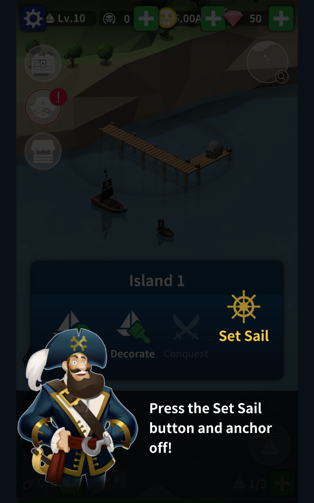
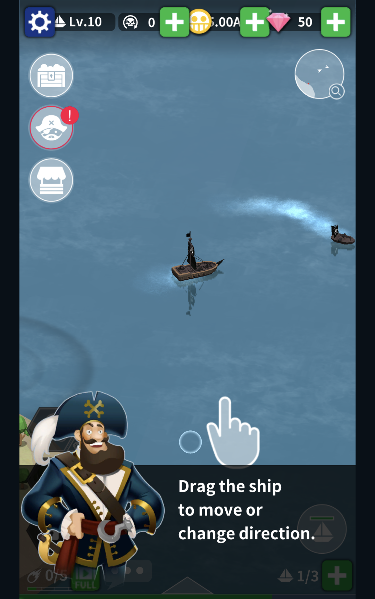
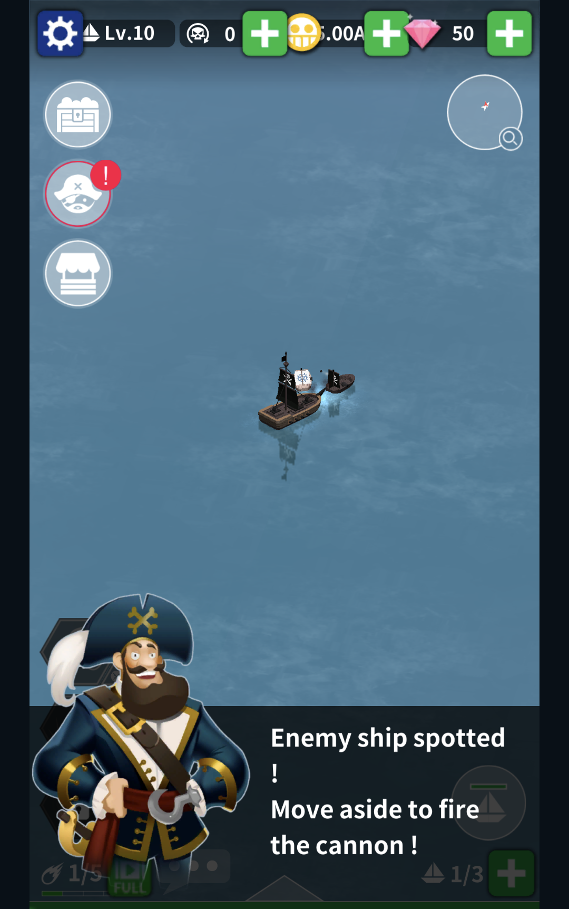

# Good Pirate 1.13 Reconstruction

An unofficial offline reconstruction of Good Pirate 1.13 for Unity 6.
Recovered scenes, maps and managed gameplay are combined with reconstruction
services for browser controls, saves and local reward claims.

[Play preview](https://ykondrashyn.github.io/good-pirate/play/) ·
[Project homepage](https://ykondrashyn.github.io/good-pirate/) ·
[Releases](https://github.com/ykondrashyn/good-pirate/releases) ·
[Report a problem](https://github.com/ykondrashyn/good-pirate/issues)

[](https://github.com/ykondrashyn/good-pirate/releases/download/gp113-v0.1.0-preview.1/good-pirate.apk)
[](https://github.com/ykondrashyn/good-pirate/releases/tag/gp113-v0.1.0-preview.1)

**Downloads:** [Android APK (59 MB)](https://github.com/ykondrashyn/good-pirate/releases/download/gp113-v0.1.0-preview.1/good-pirate.apk) ·
[WebGL ZIP](https://github.com/ykondrashyn/good-pirate/releases/download/gp113-v0.1.0-preview.1/good-pirate-webgl-v0.1.0-preview.1.zip) ·
[All release files](https://github.com/ykondrashyn/good-pirate/releases/tag/gp113-v0.1.0-preview.1)

This is a reconstruction preview, not a claim of full game parity.
See [STATUS.md](STATUS.md) for current acceptance and limitations.

> [!TIP]
> **Like sailing games? Play DOKDO free in your browser.**
> [DOKDO](https://dokdo.online/?ref=good-pirate) is a similar low-poly sailing
> game: captain your ship, fish, trade, upgrade your fleet, take islands and
> fight the Kraken. It runs on phone and PC, including iOS and Android, with no
> download and no account. Sail a shared sea with other captains, with chat and
> ship emotes.
>
> **[▶ Play DOKDO at dokdo.online](https://dokdo.online/?ref=good-pirate)** ·
> [DOKDO on GitHub](https://github.com/ykondrashyn/dokdo.online) ·
> [Join the Discord](https://discord.gg/Fx9uaS5Mgd)

## About the game

Good Pirate is a portrait-format pirate sailing game with low-poly ships and
islands. You captain a ship, explore the sea, fight enemy vessels and build up
your fleet. Island visits, ship upgrades, sailors and fleet formations are
part of its progression. The recovered 1.13 project also contains patrols,
boss encounters, fishing and island conquest systems.

This project brings that version into Unity 6 with browser controls and local
saves. It retains 16 recovered map resources. Former paid products use free
local claims, and retired online services are not required to play. These are
reconstruction changes, not features of the original release.

The public build is a **smoke-tested preview**. Short browser checks covered
steering, early tutorial combat, Settings and Copy Save. Full progression,
all content and mobile controls have not completed acceptance testing.

## Screenshots

Captured from the current WebGL release during its Chromium smoke checks on
2026-10-17. Click a screenshot to view it at full size. Tutorial overlays are
part of the game, not added to the images.

<p>
  <a href="docs/screenshots/harbor-tutorial.png"></a>
  <a href="docs/screenshots/steering-tutorial.png"></a>
  <a href="docs/screenshots/cannon-tutorial.png"></a>
</p>

Left to right: leaving the harbor, learning to steer and the cannon tutorial.
See [screenshot provenance](docs/screenshots/README.md) for capture details.

## Downloads

### Android APK

Download the preview APK from the latest pre-release:

- **[good-pirate.apk](https://github.com/ykondrashyn/good-pirate/releases/download/gp113-v0.1.0-preview.1/good-pirate.apk)** (59 MB)
- SHA-256: `f3fbd93875d90eecff22e87aa83fad2015b13cc8e69b4036135761d7dd127105`
- Also listed in the release [`SHA256SUMS`](https://github.com/ykondrashyn/good-pirate/releases/download/gp113-v0.1.0-preview.1/SHA256SUMS)

**Install on Android:**

1. Download `good-pirate.apk` on your phone.
2. Allow installing apps from unknown sources (Chrome or Files will prompt, or enable it in Settings → Security).
3. Open the downloaded APK and tap Install, then Open.

Android acceptance is still incomplete for this preview. Keep a Copy Save backup of progress when possible.

### WebGL

The browser build is available as a [WebGL ZIP](https://github.com/ykondrashyn/good-pirate/releases/download/gp113-v0.1.0-preview.1/good-pirate-webgl-v0.1.0-preview.1.zip) for local hosting, or play the hosted preview at [ykondrashyn.github.io/good-pirate/play](https://ykondrashyn.github.io/good-pirate/play/). Serve the ZIP contents over HTTP or HTTPS; do not open `index.html` as a local file.

## Play and save

Hold and drag on the sea to steer. Release to stop accelerating. Follow the
recovered tutorial and use the on-screen controls to manage your fleet.
Portrait presentation is preserved. Click or tap to enable browser audio.

Progress saves locally. In Settings, **Copy Save** exports a checksummed save
document. **Paste Save** asks for confirmation before replacing progress and
reloading. Invalid saves are rejected and a pre-import recovery copy is kept.
Transfer localhost progress by copying there and pasting in the hosted game.
Clearing browser storage can remove progress, so keep an exported backup.

Former paid products use free local claims. Permanent unlocks are guarded
against duplicate grants, daily offers retain their limits and currency
products are repeatable. No payment, advertising or original online service
is contacted.

## Build

Install Unity **6000.3.18f1** with **Web Build Support**. Open this directory as
a Unity project. Unity restores the pinned packages. The original APK, private
evidence archive and obsolete SDK installations are not required to compile.

On macOS:

```sh
./tool/unity-compile.sh
./tool/unity-test-editmode.sh
python3 tool/publication.py audit
./tool/build-publication.sh
python3 tool/publication.py candidate
python3 -m http.server 8795 --bind 127.0.0.1 --directory Builds/PublicTest
```

Open `http://127.0.0.1:8795/good-pirate/play/`. Set `UNITY_EDITOR` when the
editor is installed elsewhere. Publication builds require a clean committed
source checkout. GitHub Actions deploys already tested release artifacts and
does not need a Unity license or private build credentials.

## Identity and provenance

- Unity: `6000.3.18f1`, Built-in Render Pipeline, Gamma
- Package: `com.reconstruction.goodpirate113`
- Product: `Good Pirate 1.13 Reconstruction`
- Original authority: Good Pirate 1.13, Unity `2018.3.11f1`, Mono, ARMv7
- Recovered maps: 16
- First public target: WebGL preview, Android acceptance remains separate

See [provenance and dependencies](docs/publication/PROVENANCE.md) and the
[publication protocol](docs/publication/README.md). Original material retains
its original ownership. This project is not associated with or endorsed by
the original developer. No blanket open-source license covers recovered code
or assets.

The original APK and raw reverse-engineering artifacts remain outside this
repository. Historical evidence tools are optional research utilities, not
build prerequisites. Nothing here publishes to or changes `dokdo.online`.

## More sailing: DOKDO

If you enjoy Good Pirate, try **DOKDO**, a free browser sailing game with a
shared sea, chat and emotes. It plays on phone and PC (iOS, Android, Windows,
macOS and Linux) with no install or account.

- Play: <https://dokdo.online/?ref=good-pirate>
- Repository and guide: <https://github.com/ykondrashyn/dokdo.online>
- Community: <https://discord.gg/Fx9uaS5Mgd>

DOKDO is a separate project. Good Pirate releases and builds do not deploy to
or modify it.
